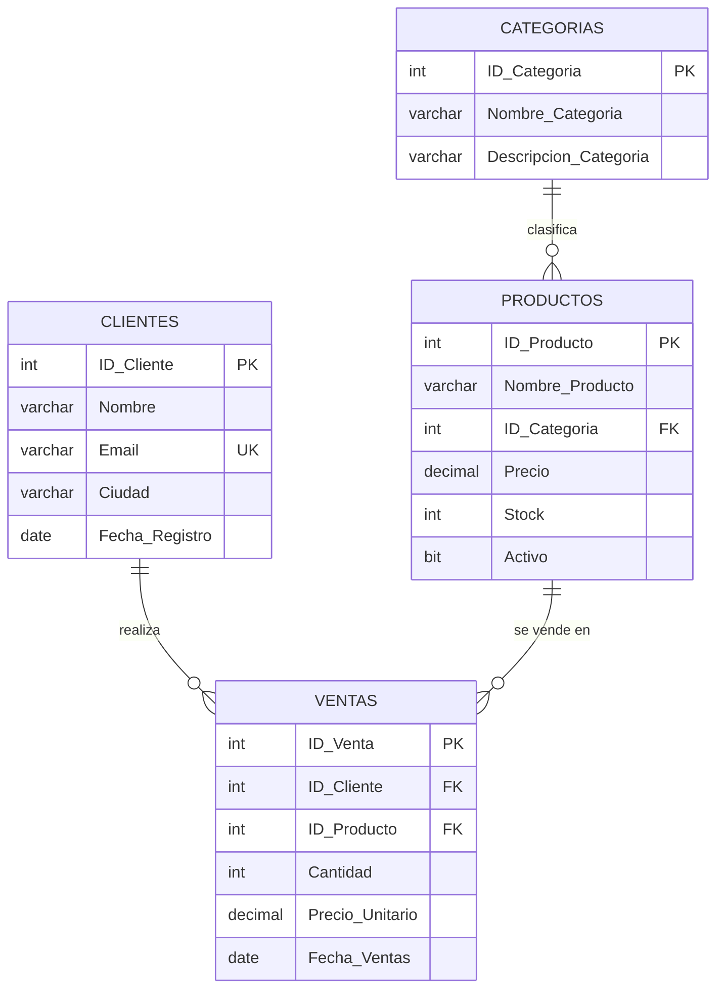
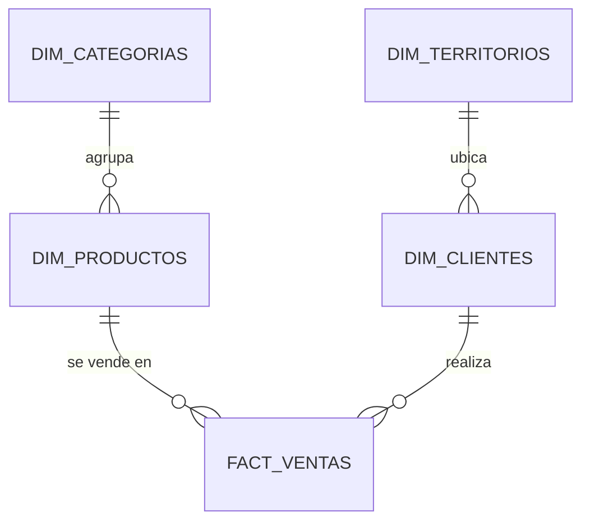

# Ventas_Tech_DB | Análisis de ventas para RetailPro

Proyecto de análisis de datos que modela una base de datos relacional de ventas de tecnología en **SQL Server**, la consulta con **T-SQL** para obtener indicadores de negocio y la conecta a **Power BI** para construir un dashboard ejecutivo.

## Tabla de contenidos

- [Objetivos](#objetivos)
- [Herramientas](#herramientas)
- [Modelo de datos](#modelo-de-datos)
- [Scripts SQL incluidos](#scripts-sql-incluidos)
- [Cómo ejecutar los scripts](#cómo-ejecutar-los-scripts)
- [Consultas de análisis](#consultas-de-análisis)
- [Conexión con Power BI](#conexión-con-power-bi)
- [Autor](#autor)

## Objetivos

**Objetivo general:** apoyar la toma de decisiones de RetailPro con evidencia cuantitativa, en lugar de intuiciones comerciales, a partir del historial de sus transacciones.

**Objetivos específicos:**

- Diseñar una base de datos relacional (`Ventas_Tech_DB`) con claves primarias, claves foráneas y restricciones de integridad.
- Cargar datos de ejemplo y validar su contenido con consultas de control.
- Resolver preguntas de negocio con SQL: resúmenes por mes, rankings de productos, clientes recurrentes y comparaciones contra el promedio.
- Cruzar tablas con `INNER JOIN` y `LEFT JOIN` para obtener una vista base de ventas e identificar clientes y productos sin movimiento.
- Consolidar resultados con `UNION ALL` y valores literales creados dentro de la consulta.
- Conectar los datos a Power BI y aplicar un proceso ETL para construir un dashboard con KPIs, tendencia, comparación por categoría y detalle de transacciones.

## Herramientas

| Herramienta | Uso |
|---|---|
| Microsoft SQL Server (T-SQL) | Motor de base de datos |
| SQL Server Management Studio (SSMS) | Ejecución de scripts y consultas |
| Power BI Desktop / Power Query | ETL, modelado y dashboard |
| Git y GitHub | Control de versiones y publicación |

## Modelo de datos

La base `Ventas_Tech_DB` tiene cuatro tablas relacionadas:



| Tabla | Descripción | Filas de ejemplo |
|---|---|---|
| `Categorias` | Rubros de productos | 4 |
| `Clientes` | Maestro de compradores | 5 |
| `Productos` | Catálogo de mercadería | 6 |
| `Ventas` | Transacciones (tabla de hechos) | 10 |

## Scripts SQL incluidos

| Archivo | Contenido |
|---|---|
| `Ventas_Tech_DB.sql` | Crea la base de datos y las tablas, inserta los datos de ejemplo y ejecuta las consultas de validación. |
| `Consultas_Ventas_Tech_DB.sql` | Cuatro consultas de resumen: mensual, ranking, clientes recurrentes y comparación contra el promedio. |
| `m5_consultas_joins.txt` | Cuatro consultas con `JOIN` y `UNION ALL`: vista base, clientes sin ventas, productos sin ventas y consolidado por canal. |

Cada consulta tiene un encabezado con su propósito y un comentario `-- Hallazgo:` con la lectura de negocio.

## Cómo ejecutar los scripts

### Requisitos

- **SQL Server 2016 o superior**.
- **SSMS** o cualquier cliente que entienda el separador de lotes `GO`.
- Permiso para crear bases de datos en la instancia.

### 1. Clonar el repositorio

```bash
git clone https://github.com/TriAlex123/DataAnalitycs-CoderHouse.git
cd DataAnalitycs-CoderHouse
```

### 2. Crear la base de datos y cargar los datos

**Desde SSMS**

1. Conectate a tu instancia de SQL Server.
2. Abrí el archivo con **Archivo > Abrir > Archivo...** y seleccioná `Ventas_Tech_DB.sql`.
3. Presioná **F5** (o **Ejecutar**).
4. En la pestaña **Resultados** vas a ver las cuatro consultas de validación.

**Desde la línea de comandos (`sqlcmd`)**

```bash
sqlcmd -S localhost -E -f 65001 -i Ventas_Tech_DB.sql
```

- `-E` usa autenticación de Windows. Para autenticación de SQL Server, usá `-U usuario -P contraseña`.
- `-f 65001` lee el archivo en UTF-8 para conservar las tildes.
- Si usás una instancia con nombre, reemplazá `localhost` por `.\SQLEXPRESS` u otro nombre.

El script es **repetible**: elimina las tablas si existen (en orden inverso a sus dependencias) y las vuelve a crear. No lo ejecutes sobre una base con datos que quieras conservar.

### 3. Validar la carga

Las consultas finales del script deben devolver:

| Consulta | Filas esperadas |
|---|---|
| `SELECT * FROM Categorias` | 4 |
| `SELECT * FROM Clientes` | 5 |
| `SELECT * FROM Productos` | 6 |
| `SELECT * FROM Ventas` | 10 |

### 4. Ejecutar las consultas de análisis

Con la base ya creada, ejecutá los otros scripts de la misma forma.

```bash
sqlcmd -S localhost -E -f 65001 -i Consultas_Ventas_Tech_DB.sql
sqlcmd -S localhost -E -f 65001 -d Ventas_Tech_DB -i m5_consultas_joins.txt
```

`m5_consultas_joins.txt` no incluye `USE Ventas_Tech_DB;`. Desde SSMS, abrilo en una ventana de consulta y elegí `Ventas_Tech_DB` en el desplegable de bases de datos antes de ejecutar. Desde `sqlcmd`, el parámetro `-d` cumple esa función.

## Consultas de análisis

| # | Consulta | Técnica SQL | Resultado con los datos de ejemplo |
|---|---|---|---|
| 1 | Resumen ejecutivo mensual | `SUM`, `COUNT`, `AVG`, `GROUP BY MONTH()` | Una fila: marzo, $6.444,00 facturado, 10 pedidos, ticket promedio $644,40 |
| 2 | Ranking de productos | `TOP 5`, `ORDER BY` | Productos 1, 3, 5, 6 y 2 |
| 3 | Clientes recurrentes | `HAVING COUNT(*) > 1` | Los 5 clientes, con 2 pedidos cada uno |
| 4 | Productos sobre y bajo el promedio | `WITH` (CTE), `CASE WHEN` | Promedio $1.074,00: los productos 1 y 3 quedan por encima |
| 5 | Vista base de ventas | `INNER JOIN` de 4 tablas | 10 filas con cliente, ciudad, producto, categoría e importes |
| 6 | Clientes sin ventas | `LEFT JOIN ... IS NULL` | 0 filas: todos los clientes compraron |
| 7 | Productos sin ventas | `LEFT JOIN ... IS NULL` | 0 filas: todos los productos se vendieron |
| 8 | Consolidado por canal | `UNION ALL` + `GROUP BY` | Tramo 1 (01-10 mar): $3.620,00; Tramo 2 (11-31 mar): $2.824,00 |

El total facturado de las ventas de ejemplo es de **$6.444,00**.

## Conexión con Power BI
 
Después de construir la base `Ventas_Tech_DB` en SQL Server, el proyecto creció en la práctica del **Pipeline ETL**. El modelo original, de 4 tablas y 10 ventas de marzo de 2024, se amplió con un dataset más completo, nuevas tablas, relaciones, consultas de Power Query y medidas de DAX para alimentar el dashboard.

1. En Power BI Desktop, elegí **Inicio > Obtener datos > SQL Server**.
2. Ingresá el nombre del servidor y la base `Ventas_Tech_DB`.
3. Seleccioná las tablas o pegá la consulta de vista base (`INNER JOIN`) en **Opciones avanzadas**.
4. En **Transformar datos** (Power Query), aplicá el proceso ETL:
   - eliminar duplicados por columna de ID;
   - tratar valores nulos con un criterio justificado;
   - corregir los tipos de datos;
   - renombrar las consultas como `Dim_Clientes`, `Dim_Productos`, `Dim_Categorias` y `Fact_Ventas`.
5. Verificá en la **Vista de modelo** que las relaciones sean de uno a varios.

## Evolución del proyecto hacia Power BI
 
| Aspecto | Base SQL inicial | Modelo del Pipeline ETL |
|---|---|---|
| Tablas | 4 (`Categorias`, `Clientes`, `Productos`, `Ventas`) | 5 (`Dim_Categorias`, `Dim_Clientes`, `Dim_Productos`, `Dim_Territorios`, `Fact_Ventas`) |
| Clientes | 5 | 11 únicos (12 filas con 1 duplicado) |
| Productos | 6 | 12 únicos (13 filas con 1 duplicado) |
| Ventas | 10 | 50 |
| Período | Marzo de 2024 | Enero de 2023 a julio de 2024 |
| Territorios | No existía | 9 ciudades en 2 regiones (Cono Sur y Región Andina) |
| Nomenclatura | Tablas con nombre simple | Prefijos `Dim_` y `Fact_` (modelo dimensional) |
 
### Tablas y columnas incorporadas
 
| Tabla | Columnas nuevas respecto del modelo SQL |
|---|---|
| `Dim_Territorios` (nueva) | `id_territorio`, `ciudad`, `pais`, `region` |
| `_Medidas` (nueva) | `4 nuevas métricas realizadas con lenguaje DAX` |
| `Dim_Clientes` | `pais`, `segmento` (Retail, Corporativo o Mayorista) |
| `Dim_Productos` | `categoria`, `subcategoria`, `costo` |
| `Fact_Ventas` | `canal` (Online o Presencial), `descuento`, `total_venta`, y, a partir del merge, `nombre_producto` y `categoria_producto` |
 
### Relaciones del modelo
 
Todas las relaciones son de **uno a varios (1:\*)**.
 

 
| Relación (lado 1) | Relación (lado \*) |
|---|---|
| `Dim_Categorias` | `Dim_Productos` |
| `Dim_Productos` | `Fact_Ventas` |
| `Dim_Clientes` | `Fact_Ventas` |
| `Dim_Territorios` | `Dim_Clientes` |
 
Con `Dim_Territorios` unida a `Dim_Clientes`, cada venta se puede analizar por región a través del cliente que la realizó.
 
### Consultas de Power Query (ETL)
 
Se trabajó con cinco consultas: `Dim_Clientes`, `Dim_Productos`, `Dim_Categorias`, `Dim_Territorios` y `Fact_Ventas`. El dataset traía problemas de calidad de datos intencionales que había que detectar y resolver:
 
| Tabla | Problema detectado | Tratamiento |
|---|---|---|
| Clientes | `id_cliente` 1 duplicado | Eliminar duplicados por ID |
| Clientes | Email nulo (cliente 9) | Reemplazar por "Sin dato" |
| Clientes | Ciudad nula (cliente 11) | Reemplazar por "Sin dato" |
| Productos | `id_producto` 103 duplicado | Eliminar duplicados por ID |
| Productos | Precio nulo (producto 109) | Recuperar el valor desde `Fact_Ventas` (precio unitario de venta) |
| Productos | Categoría nula (producto 111) | Asignar "Computación", según su subcategoría "Laptops" |
 
Pasos aplicados en Power Query:
 
1. Conexión a los datos de la práctica.
2. Revisión de calidad y distribución de columnas.
3. Eliminación de duplicados por columna de ID.
4. Tratamiento de nulos.
5. Corrección de tipos de datos (fechas en formato dd/mm/aaaa e importes con formato regional).
6. Renombrado de las consultas con prefijos `Dim_` y `Fact_`.
7. **Merge** entre `Fact_Ventas` y `Dim_Productos` para enriquecer las ventas con el nombre del producto y la categoría.
### Medidas de DAX
 
| Medida | Qué calcula |
|---|---|
| `Ventas Totales` | Suma de `total_venta` |
| `Pedidos` | Cantidad de ventas (`id_venta` distintos) |
| `Ticket Promedio` | Ventas totales dividido por pedidos |
| `Unidades Vendidas` | Suma de `cantidad` |
| `Costo Total` | Suma de `cantidad × costo` de cada producto vendido |
| `Margen Bruto %` | (Ventas totales − costo total) / ventas totales |
| `Crecimiento %` | Variación de ventas de enero a julio de 2024 contra el mismo período de 2023 |
 
### Resultados validados
 
| Indicador | Valor |
|---|---|
| Ingresos totales | $47.578,00 |
| Pedidos | 50 |
| Unidades vendidas | 190 |
| Margen bruto | 32,4% (costo total $32.174) |
| Crecimiento total (ene-jul 2024 vs 2023) | +44,4% |
| Crecimiento Región Andina | -21,6% |
 
Estos resultados alimentan los 4 KPIs, el gráfico de tendencia mensual, la comparación por categoría y la tabla de transacciones del dashboard.

### Dashboard

El tablero sigue el patrón de lectura en Z y se organiza en zonas:

- **Zona superior:** 4 KPIs (ingresos totales, unidades vendidas, margen bruto % y crecimiento de la región en alerta).
- **Zona media izquierda:** gráfico de líneas con la evolución mensual de ventas.
- **Zona media derecha:** gráfico de barras que compara ventas por categoría.
- **Zona inferior:** tabla con el detalle de transacciones.

## Autor

**Alex Izaguirre** | [GitHub: TriAlex123](https://github.com/TriAlex123)
Proyecto realizado con fines académicos.
